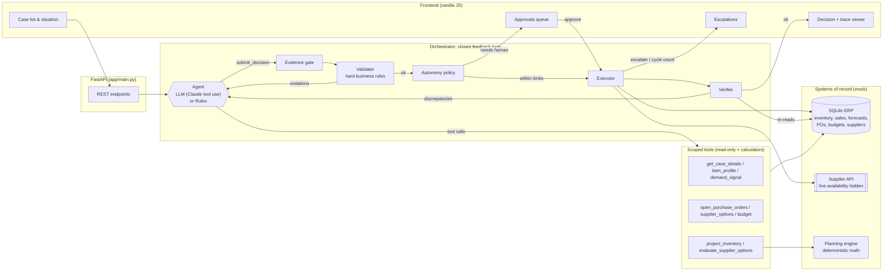

# Architecture

## Diagram



## Components

| Component | File | Responsibility |
|---|---|---|
| ERP data model | `app/db.py`, `app/seed.py` | SKUs, nodes, inventory + slot capacity, 28-day sales, forecasts, promotions, suppliers and supplier-products (cost, MOQ, case pack, lead time, modification policy), POs, budgets, recommendations, cases, runs, approvals, escalations |
| Repository | `app/repository.py` | The only read path into the ERP |
| Planning engine | `app/planning.py` | Demand classification, day-by-day projection with lost sales, order-up-to net requirement, pack rounding, supplier evaluation, split-delivery planning |
| Tools | `app/agent/tools.py` | 8 read/calculator tools scoped to the case's SKU × node; every call logged to the trace |
| Agents | `app/agent/llm.py`, `app/agent/rules.py` | Produce a `Decision` (verdict, summary, key factors, actions) |
| Orchestrator | `app/agent/orchestrator.py` | Runs the loop, owns all writes, handles approval resume and loop exhaustion |
| Validator | `app/validator.py` | Deterministic pre-execution checks, recomputed from the ERP |
| Policy | `app/policy.py` | Autonomy limits (value threshold, destructive changes, low confidence) |
| Executor | `app/executor.py` | Creates/modifies/cancels POs, commits budget, records escalations; returns expected vs actual |
| Supplier API | `app/supplier_api.py` | External system: may partially confirm, reject, or refuse modifications |
| Verifier | `app/verifier.py` | Re-reads the ERP after execution and checks the outcome |

## The decision contract

```json
{
  "verdict": "accept | modify | reject | investigate | escalate",
  "summary": "…for the buyer…",
  "key_factors": ["…"],
  "daily_demand_used": 91.3,
  "confidence": "high | medium | low",
  "actions": [
    {"type": "create_po", "supplier_id": "SUP-F", "quantity": 60, "delivery_day": 2, "reason": "…"},
    {"type": "modify_po", "po_id": "PO-7001", "quantity": 960, "reason": "…"},
    {"type": "escalate", "reason": "…", "options": ["…"]},
    {"type": "request_cycle_count", "reason": "…"}
  ]
}
```

## Key design decisions

1. **The LLM proposes; deterministic code disposes.** The agent has read tools and calculators only. All writes go
   through validator → policy → executor, so a hallucinated quantity or supplier can never reach the ERP unchecked.
2. **Arithmetic is a tool, not a thought.** Requirements, projections, rounding and constraint checks are computed
   by `planning.py`. The LLM's value is in *judgement*: which demand signal to trust, which lever to pull, when to
   escalate. The math it relies on is unit-tested.
3. **The validator does not trust the agent.** It recomputes demand and requirement from the ERP rather than using
   numbers quoted in the decision. The verifier re-reads the POs from the ERP rather than trusting the executor's
   return value.
4. **Tools are scoped to the case.** No tool takes a SKU or node argument, so the agent cannot act on the wrong item.
5. **Supplier truth is only known after acting.** The catalogue hides live availability, as in reality. This is
   what makes post-execution verification necessary rather than decorative.
6. **Feedback returns in the agent's own conversation.** For the LLM, violations and discrepancies come back as
   the `tool_result` of its `submit_decision` call, so it revises with its full investigation context.
7. **Bounded loop, safe failure.** After `MAX_REVISIONS` re-plans the orchestrator escalates to a human with the
   last feedback, and never executes an unvalidated guess.
8. **Humans at the right points.** High-value commitments pause for approval; the proposal is **re-validated at
   execution time** in case the world changed while it waited. Escalations and cycle counts are always allowed.
9. **Two interchangeable agents.** The rules agent uses the same tools and contract. It is the baseline for
   evaluating the LLM, the offline mode, and executable documentation of the buyer playbook.
10. **Reproducible world.** A fixed simulation date and deterministic supplier responses make every run and eval
    repeatable.

## Data model (main tables)

```
skus(id, name, category, shelf_life_days, safety_stock_days)
inventory(sku_id, node_id, on_hand, storage_capacity, last_counted)
sales_history(sku_id, node_id, day, units)            -- 28 days
forecasts(sku_id, node_id, daily_units, method)
promotions(sku_id, node_id, start_day, end_day, description)
suppliers(id, name, status, on_time_rate, fill_rate)
supplier_products(supplier_id, sku_id, unit_cost, moq, case_pack, lead_time_days,
                  is_primary, accepts_modifications, live_available_units*)   -- *hidden from agent
purchase_orders(id, sku_id, node_id, supplier_id, qty_ordered, qty_confirmed, status,
                shipping_status, expected_arrival, created_by, source_run_id)
budgets(node_id, category, period, total, committed)
recommendations(id, sku_id, node_id, supplier_id, quantity, rationale)
cases(id, scenario, title, description, sku_id, node_id, recommendation_id, po_id, event)
agent_runs(id, case_id, mode, status, decision, trace) · approvals(...) · escalations(...)
```

## Run statuses

| Status | Meaning |
|---|---|
| `completed` | Actions executed and outcome verified |
| `completed_with_escalation` | Verified, with part of the problem handed to a human (budget gap, cycle count, no viable supplier) |
| `awaiting_approval` | Valid proposal paused for buyer sign-off |
| `escalated` | Agent could not reach a validated and verified plan within the revision budget |
| `rejected_by_human` / `stale_approval` | Buyer rejected; or the approved plan was no longer valid at execution |
| `failed` | Agent error (e.g. model refusal); nothing executed |
